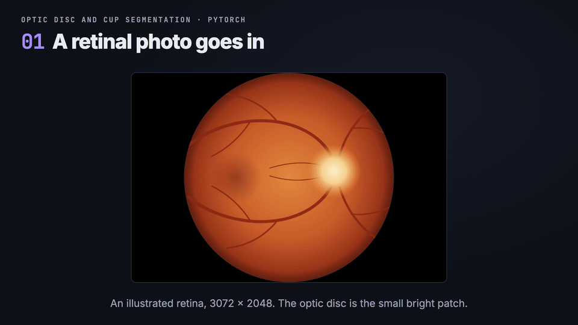
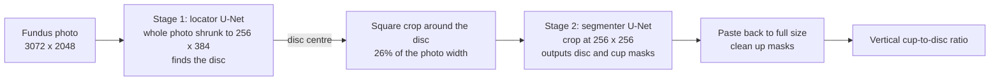
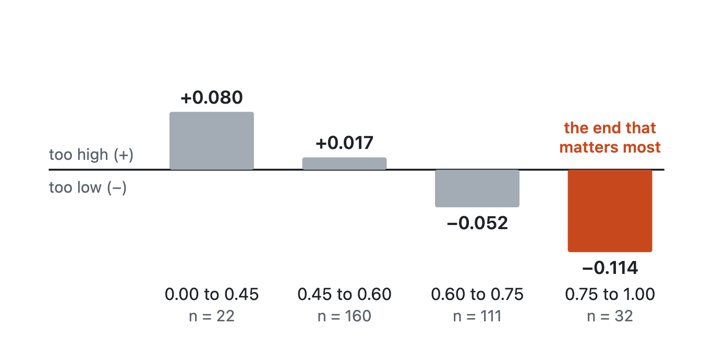

# Optic disc and cup segmentation for glaucoma screening

[](https://github.com/smhassanraza1/glaucoma-disc-cup-segmentation/actions/workflows/tests.yml)


[](LICENSE)

> **Research demo, not a medical tool.** It was trained on 275 photos from one dataset and has never been
> validated clinically. Do not use it to screen, diagnose or treat anyone.

A PyTorch pipeline that finds the **optic disc** and the **optic cup** in a retinal (fundus) photograph and
measures the **vertical cup-to-disc ratio** (vCDR), a number ophthalmologists use when looking for glaucoma.



The full write-up, with the reasoning behind each choice, is on Medium:
[Measuring the optic cup from a photo of the eye with a two-stage U-Net](https://medium.com/@smhassanraza1/measuring-the-optic-cup-from-a-photo-of-the-eye-with-a-two-stage-u-net-2324a78775fe).

**At a glance** (325 held-out test photos, ORIGA set B):

- Outlines close to the specialist's: Dice **0.962** for the disc, **0.881** for the cup.
- Cup-to-disc ratio within **0.063** of the specialist's on average, against 0.094 for a constant guess; in the
  same range as the published M-Net results on the same split.
- Honest about where it fails: the ratio is pulled toward the middle, and large cups are underestimated
  (see [Results](#results)).
- Two-stage U-Net (ResNet34 encoder), trained in about 11 minutes on a laptop; 40 unit tests on synthetic
  data, a Gradio demo and a Dockerfile.

## The idea in plain terms

- The **optic disc** is the spot where the optic nerve leaves the eye. In a fundus photo it is a bright round
  patch. The **cup** is the paler pit in its centre.
- In glaucoma the nerve is damaged and the cup grows. The **vertical cup-to-disc ratio** is the cup's height
  divided by the disc's height. Higher means more suspicious.
- **Segmentation** means labelling every pixel of a photo: disc, cup, or neither. Measuring the ratio from
  those labels turns a picture into a number.

## How it works



- **Two stages, because the disc is small.** It covers about 1.6% of the photo, so one network on the whole
  photo would see the cup as a few pixels. Stage 1 only has to find the disc. Stage 2 then looks at a crop
  where the disc and cup are large.
- **U-Net.** An encoder shrinks the image to capture what is in it, a decoder grows it back to say which
  pixels, and skip connections carry fine detail across. The encoder is a ResNet34 pretrained on ImageNet
  (`src/glaucoma/model.py`); the decoder is written here.
- **Two output channels** (disc, cup), scored independently, because the cup lies inside the disc.
- **Loss:** binary cross-entropy plus soft Dice. Cross-entropy alone can score well by predicting "no cup"
  everywhere, since the cup is a tiny fraction of the pixels; Dice rewards overlap.
- **Mask clean-up** (`postprocess.py`): keep the largest blob, fill holes, force the cup inside the disc.
- **vCDR** (`vcdr.py`): the tallest column of cup pixels divided by the tallest column of disc pixels. On the
  real data this reproduces the ratio column shipped with the dataset to within its 4-decimal rounding.

## Results

Scored on the held-out test photos (ORIGA set B, 325 photos), at full 3072 x 2048 resolution, one photo at a
time and then averaged. The tables below are generated by `python -m glaucoma.evaluate` and copied here by
`scripts/update_readme.py`; a test fails if they differ. The test photos were scored once, with the first
trained model, and nothing was tuned on them afterwards.

<!-- results:start -->

| Photos | n | Disc Dice | Cup Dice | Disc IoU | Cup IoU | vCDR MAE | vCDR corr |
|---|---:|---:|---:|---:|---:|---:|---:|
| All | 325 | 0.962 | 0.881 | 0.928 | 0.794 | 0.063 | 0.693 |
| Normal | 230 | 0.962 | 0.874 | 0.927 | 0.783 | 0.061 | 0.571 |
| Glaucoma | 95 | 0.964 | 0.898 | 0.931 | 0.820 | 0.068 | 0.574 |
| Baseline: same vCDR (0.55) for every photo | 325 | – | – | – | – | 0.094 | – |

<!-- results:end -->

How to read it: **Dice** and **IoU** measure overlap with the specialist's outline (1.0 is identical, IoU is
always the lower of the two). **vCDR MAE** is the average gap between our ratio and the specialist's, so a
value of 0.05 means the predicted ratio is typically within 0.05 of the truth. **vCDR corr** is how closely
predicted and specialist ratios rise and fall together. The **baseline** row is what you would get by
guessing the same typical ratio (the training photos' median) for every photo, so it shows how much the model
adds.

**The outlines are strong; the ratio is honest but biased at the extremes.** The model beats the baseline on
vCDR error but not by a wide margin. The table below shows why: it pulls predictions toward the middle,
guessing too high for small cups and too low for large ones, and the large-cup end is the one that matters for
glaucoma.

<!-- bias:start -->

| True vCDR | n | vCDR MAE | Bias (predicted - true) |
|---|---:|---:|---:|
| 0.00 to 0.45 | 22 | 0.082 | +0.080 |
| 0.45 to 0.60 | 160 | 0.049 | +0.017 |
| 0.60 to 0.75 | 111 | 0.065 | -0.052 |
| 0.75 to 1.00 | 32 | 0.116 | -0.114 |

<!-- bias:end -->



**Comparison with published work (numbers from the paper, not re-run by us).** The standard ORIGA partition
trains on set A and tests on set B, as here. On it, Fu et al. (M-Net, 2018,
[arXiv:1801.00926](https://arxiv.org/abs/1801.00926)) report an absolute vertical-CDR error of 0.071 for their
best method, and overlap errors (1 - IoU) of 0.071 for the disc and 0.230 for the cup. With the same
definitions, our test results are 0.063 for the vCDR error and 0.072 and 0.206 for the disc and cup overlap
errors (the last two derived from the IoU columns above). Treat this as being in the same range, not as a
ranking: their pipeline, preprocessing and training differ, and the paper is from 2018.

The labels also limit what any model can score. See [Limitations](#limitations).

Worst test photos by ID are listed in [`results/failure_cases.md`](results/failure_cases.md).

## Reproduce it

Data is not included in this repository. It uses the 650-photo ORIGA set (photos plus expert disc and cup
masks in `.mat` files, and a `glaucoma.csv`) as distributed in the Kaggle dataset
`sshikamaru/glaucoma-detection`.

```bash
uv sync --extra dev
# extract so that data/raw/ORIGA/ORIGA/Images, data/raw/ORIGA/ORIGA/Semi-automatic-annotations
# and data/raw/glaucoma.csv exist
uv run python -m glaucoma.train locator   --epochs 25     # about 5 min on an Apple M4 (measured)
uv run python -m glaucoma.train segmenter --epochs 40     # about 6 min on an Apple M4 (measured)
uv run python -m glaucoma.evaluate                        # writes results/metrics.json, table.md, bias.md
uv run python scripts/update_readme.py
uv run pytest
```

The device is picked automatically: CUDA, then Apple Metal (MPS), then CPU. Evaluating the same checkpoints
gives identical numbers on repeat runs, but the results above come from a single training run: training was
not repeated, so run-to-run variation is unmeasured.

**Demo** (upload a photo, see the outlines and the ratio):

```bash
uv run --extra demo python app/demo.py
```

**Docker** (CPU only; mount your trained checkpoints):

```bash
docker build -t glaucoma-seg .
docker run --rm -p 7860:7860 -v "$PWD/checkpoints:/app/checkpoints:ro" glaucoma-seg
```

## Data and splits

The photos and masks are **not included** in this repository. They come from ORIGA-light (Zhang et al., "ORIGA-light:
An online retinal fundus image database for glaucoma analysis and research", EMBC 2010, pp. 3065-3068), obtained
through the Kaggle copy named above. The dataset's own readme states that it is released for academic research use
only; please read it before using the data.

- 650 photos; photo 359 is excluded because its image and mask have different widths (3085 vs 3072 px),
  leaving 649.
- **Test:** the 325 photos the dataset labels set B. **Train and validation:** the 324 usable photos of set A,
  split 85/15 with the glaucoma ratio preserved (275 train, 49 validation).
- Augmentation (training only): horizontal flip, small shifts, scale and rotation, brightness and contrast.

## Limitations

- **One small dataset from one source.** 275 training photos. We do not know how it behaves on other cameras,
  populations or photo quality. There is no external test set; results on other cameras or populations are unmeasured.
- **Possible patient overlap.** The A/B partition is the one used in published ORIGA work, but the data has no
  patient ID, so left and right eyes of one person may fall on both sides of the split.
- **Easy-to-match labels.** The masks come from a semi-automatic annotation tool and look like smooth ellipses.
  Scores against such labels run higher than against hand-drawn consensus outlines, so they cannot be compared
  with results on other benchmarks.
- **Segmentation, not diagnosis.** The pipeline measures a ratio. A ratio alone does not diagnose glaucoma;
  clinicians also use pressure, visual fields, nerve-fibre imaging and more.
- **Stage 1 can fail** on photos where the disc is not visible or not near where it usually is; stage 2 then
  crops the wrong area.
- **Not a medical device.** It has had no clinical validation of any kind.

## Layout

```
src/glaucoma/   data, model, losses, metrics, vcdr, postprocess, pipeline, train, evaluate
app/demo.py     Gradio demo
assets/         images used in this README
scripts/        README table updater
tests/          unit tests, built on synthetic photos (no dataset needed)
results/        metrics.json, table.md, failure_cases.md (figures are not committed)
```
